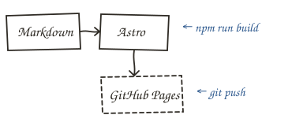

---
# ENTRADA DE EJEMPLO
# Enseña todos los elementos del cuaderno y cómo se escriben.
# Cópiala a src/content/entradas/<tu-expedicion>/ y cambia los textos.

titulo: Anatomía de una entrada
numero: 1
fecha: 2026-10-25
resumen: Esto es el «resumen». Sale en el registro de la expedición.
lugar: esto es «lugar»
clima: «clima» ☂
material:
  - Esto es «material»
  - Una lista con
  - lo que usaste
boceto: ./bocetos/boceto.svg
pieBoceto: Fig. 1 — esto es «boceto» con su «pieBoceto»
aprendido:
  - Esto es «aprendido»
  - Ideas cortas, a mano
notas:
  - Esto es «notas» — anotaciones sueltas para la página izquierda, cada una con su flecha.
  - Úsalas para comentarios que no encajan en el texto.
borrador: true
---

Esto es un **párrafo normal**. Todo lo que escribas en el archivo después del bloque de datos aparece en esta página derecha. La página izquierda se rellena sola con los datos del principio: la cabecera con número, fecha, lugar y clima, el material, el boceto, lo aprendido y las notas.

<aside class="margen derecha">Esto es una anotación en el lado derecho. El texto de al lado la rodea.</aside>

Las **notas al margen** son anotaciones escritas a mano que flotan junto al texto, como cuando escribes en el borde de una hoja. La que tienes a la derecha se escribe justo antes del párrafo al que acompaña. En el móvil no hay sitio en los lados, así que pasan a ocupar su propia línea, con la raya a la izquierda.

~~~html
<aside class="margen derecha">Anotación en el lado derecho.</aside>
~~~

<aside class="margen izquierda roja">Esto es una anotación en el lado izquierdo, con tinta roja.</aside>

También puedes ponerlas en el **lado izquierdo** y cambiar el color de la tinta. Por defecto se escriben en azul. Añade `roja` para errores y avisos, o `lapiz` para algo más discreto, en gris. El resto de la frase sigue fluyendo alrededor de la nota.

~~~html
<aside class="margen izquierda roja">Lado izquierdo, tinta roja.</aside>
<aside class="margen derecha lapiz">Lado derecho, a lápiz.</aside>
~~~

## Esto es un apartado (##)

Los títulos con `##` salen como encabezados escritos a mano en rojo. Los de `###` salen a máquina de escribir, como este:

### Esto es un subapartado (###)

> Esto es una anotación en línea: una cita de Markdown (empieza la línea con `>`). Ocupa su propia línea, con una flecha, en vez de ir a un lado.

Dentro del texto puedes marcar cosas a mano: <mark>esto está subrayado con fosforito</mark>, ~~esto está tachado~~ y <span class="circulo">esto va en un círculo</span>. Las tres se escriben así:

~~~md
<mark>fosforito</mark>, ~~tachado~~ y <span class="circulo">círculo</span>
~~~

<div class="nota"><b>¡OJO!</b> Esto es una nota con clip. Úsala para avisos, errores o cosas que no quieres que nadie se salte.</div>

~~~html
<div class="nota"><b>¡OJO!</b> Texto de la nota.</div>
~~~

## Código

Los bloques de código salen en una ficha pegada con cinta y con colores. Indica el lenguaje después de las tres comillas:

```kotlin
// Esto es un bloque de código en Kotlin
fun saludo(nombre: String) = "Hola, $nombre"
```

<aside class="margen derecha lapiz">Esto es una nota a lápiz. Las líneas largas de código se desplazan dentro de la ficha.</aside>

Si escribes `código` entre comillas invertidas sueltas, queda marcado dentro de la frase. Para tablas, listas y enlaces se usa el Markdown de siempre:

- Esto es una lista
- con [un enlace](https://docs.astro.build)

| Esto es | una tabla |
| ------- | --------- |
| campo   | valor     |

## Imágenes

Una imagen normal de Markdown sale como una foto pegada:



Y si quieres una **polaroid con pie de foto**, usa una figura (la imagen tiene que estar en la carpeta `public/`):

~~~html
<figure class="polaroid">
  
  <figcaption>Pie de foto</figcaption>
</figure>
~~~

---

La línea discontinua de arriba es un `---`: sirve para separar partes. Abajo del todo, los enlaces a la entrada anterior y siguiente se ponen solos.
